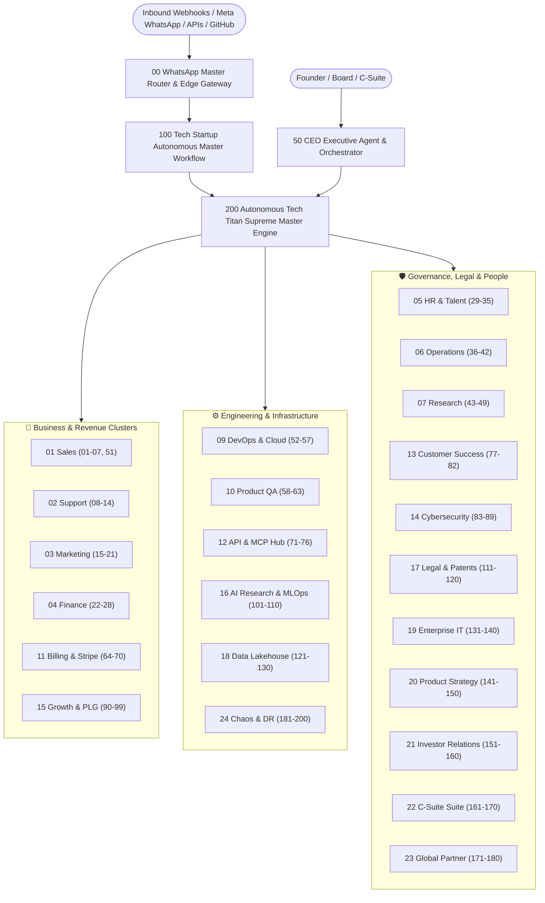

# Enterprise Tech Titan Architecture (200 AI Agents across 24 Departments)

This document specifies the end-to-end interconnected architecture for the **Enterprise Tech Titan Platform** powered by n8n, Anthropic Claude, Google Gemini, Meta WhatsApp Cloud API, and Model Context Protocol (MCP).

---

## 1. System Overview & Department Clusters

The enterprise is organized into **24 core operational departments**, coordinated by **Agent 00 (Inbound Router)**, **Agent 50 (CEO Agent)**, **Agent 100 (Autonomous Tech Master)**, and **Agent 200 (Autonomous Tech Titan Supreme Master Engine)**.

---

## 2. Distributed Memory & Inter-Agent Event Bus

1. **Cross-Agent Semantic Memory Bus (Agent 192)**:
   - All 200 agents store execution traces, customer decisions, and technical context in a centralized PostgreSQL `pgvector` embedding table.
   - Any agent can query what other agents have executed within the same customer session.
2. **Multi-Agent Load Balancer (Agent 191)**:
   - High-throughput webhook and tool invocation spikes are dynamically partitioned across n8n worker nodes.
3. **Autonomous Budget Governor (Agent 193)**:
   - Monitors token consumption across Gemini and Claude, cutting off run-away loops and enforcing hard spending ceilings per department.
4. **Self-Healing Code Patcher (Agent 199)**:
   - Ingests Sentry error traces (Agent 60), writes a targeted test and pull request, requests AST review (Agent 59), and verifies green API tests (Agent 58).

---

## 3. Technology Stack & Enterprise Scale

- **Workflow Orchestration**: n8n Enterprise (Multi-worker cluster mode)
- **Primary AI Models**: Google Gemini 1.5 Pro/Flash, Anthropic Claude 3.5 Sonnet, OpenAI GPT-4o
- **Data Persistence**: PostgreSQL 16 with pgvector & Apache Iceberg lakehouse
- **Message Broker & Cache**: Redis 7.2 Cluster with BullMQ queues
- **Payment & Metering**: Stripe Billing (High-throughput metered subscriptions)
- **Zero-Trust Identity**: Okta SAML 2.0 / SCIM + FIDO2 YubiKey enforcement
- **Chaos & SRE**: Chaos Mesh, Prometheus, Grafana, OpenTelemetry, Sentry
