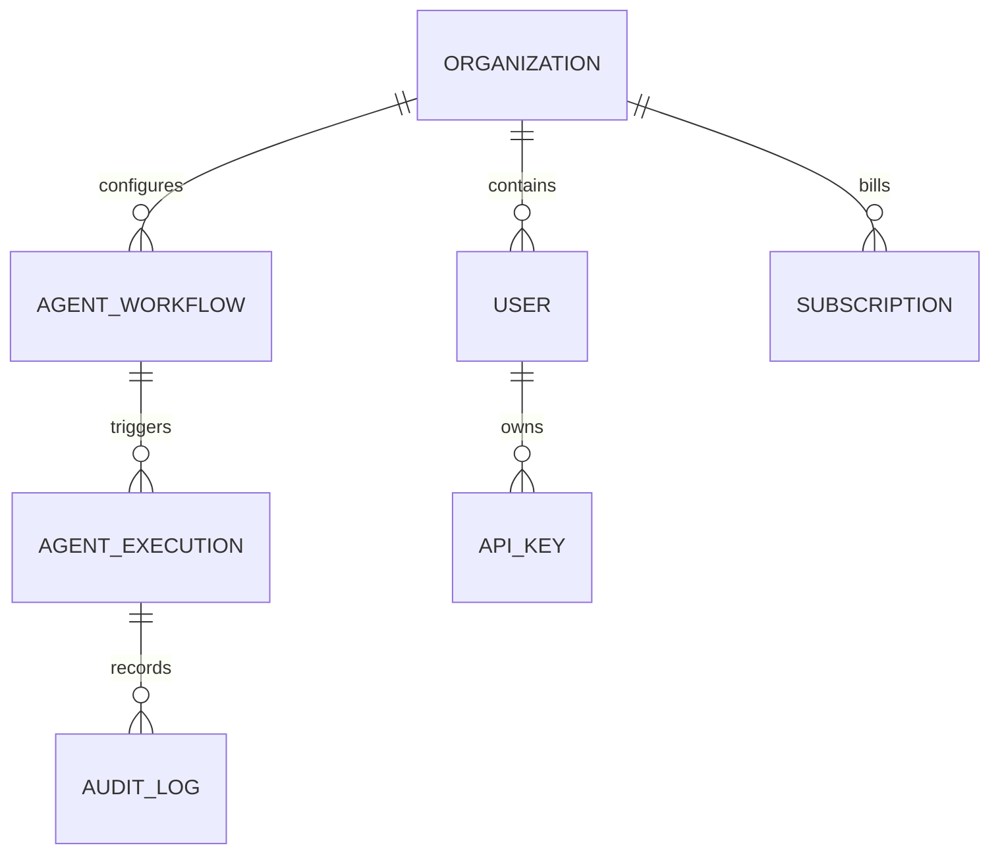

# Tech Startup Platform - System Design & Architecture Specification

## 1. System Vision & Architecture Topology

The Tech Startup Platform is an enterprise-grade Autonomous Agent Operating System designed for SaaS delivery, API integration, and business automation. It orchestrates 100 specialized AI agents across 15 operational departments using an event-driven, decoupled microservices model.

```
                              ┌────────────────────────────────────────┐
                              │            Client Layer                │
                              │   Web Dashboard | Mobile | WhatsApp    │
                              └───────────────────┬────────────────────┘
                                                  │ HTTPS / WSS
                                                  ▼
┌──────────────────────────────────────────────────────────────────────────────────────────────────┐
│                                       API Gateway & Edge Layer                                   │
│            Cloudflare CDN + WAF  │  Rate Limiting  │  JWT & API Key Auth  │  CORS Gate            │
└─────────────────────────────────────────────────┬────────────────────────────────────────────────┘
                                                  │
                                                  ▼
┌──────────────────────────────────────────────────────────────────────────────────────────────────┐
│                                   Master Orchestration Engine                                    │
│       Agent 00: WhatsApp Master Router            │      Agent 50: CEO Executive Orchestrator    │
│                      Agent 100: Tech Startup Autonomous Master Workflow                          │
└───────┬─────────────────────────────────────────┬────────────────────────────────────────┬───────┘
        │                                         │                                        │
        ▼                                         ▼                                        ▼
┌─────────────────────┐               ┌─────────────────────┐                  ┌─────────────────────┐
│  Core Business Hub  │               │   DevOps & Infra    │                  │  Growth & Marketing │
│  01: Sales & Leads  │               │  09: CI/CD & Deploy │                  │  03: Content & SEO  │
│  02: Support & Desk │               │  10: QA & Code Gen  │                  │  15: PLG & Viral    │
│  04: Finance & Tax  │               │  14: Security Shield│                  │  13: Success & NPS  │
└─────────┬───────────┘               └──────────┬──────────┘                  └──────────┬──────────┘
          │                                      │                                        │
          └──────────────────────────────────────┼────────────────────────────────────────┘
                                                 │
                                                 ▼
┌──────────────────────────────────────────────────────────────────────────────────────────────────┐
│                                   Model Context Protocol (MCP)                                   │
│         Standardized Tool Interfaces: GitHub, Linear, Stripe, PostgreSQL, Browser, Terminal      │
└────────────────────────────────────────────────┬─────────────────────────────────────────────────┘
                                                 │
                                                 ▼
┌──────────────────────────────────────────────────────────────────────────────────────────────────┐
│                                      Data Persistence Layer                                      │
│      PostgreSQL (ACID State)   │   Redis (Queues & Cache)   │   pgvector (Semantic Memory)       │
└──────────────────────────────────────────────────────────────────────────────────────────────────┘
```

---

## 2. Core Design Principles

1. **Decoupled Autonomy**: Every agent operates as an isolated execution unit capable of executing independently or as part of a chained workflow.
2. **Stateless Compute**: Agent runners maintain no internal state; session memory, idempotency keys, and message logs live in Redis and PostgreSQL.
3. **Fail-Closed Security**: Any unverified webhook, expired token, or permission breach aborts the workflow immediately.
4. **Observable by Default**: Every workflow node emits structured trace logs with correlation IDs (`X-Correlation-ID`).
5. **Zero Human Bottleneck**: Routine workflows (invoicing, bug triage, lead scoring, onboarding) execute with 100% autonomy; human review is required only for high-risk actions (deployments to production, payments above threshold).

---

## 3. UI/UX Design System & Tokens

The platform frontend dashboard is built using standard Tailwind CSS v4 design tokens, adhering to accessibility standards (WCAG 2.1 AA compliant).

### 3.1 Color Palette & Theme Tokens
```css
:root {
  /* Brand Accents */
  --color-brand-primary: #3b82f6;      /* Blue 500 */
  --color-brand-accent: #6366f1;       /* Indigo 500 */
  --color-brand-success: #10b981;      /* Emerald 500 */
  --color-brand-warning: #f59e0b;      /* Amber 500 */
  --color-brand-danger: #ef4444;       /* Rose 500 */

  /* Neutral Dark Canvas */
  --bg-app: #0b0f19;                  /* Slate 950 */
  --bg-surface: #111827;              /* Gray 900 */
  --bg-surface-elevated: #1f2937;     /* Gray 800 */
  --border-subtle: #374151;           /* Gray 700 */

  /* Typography Colors */
  --text-primary: #f9fafb;            /* Gray 50 */
  --text-secondary: #9ca3af;          /* Gray 400 */
  --text-muted: #6b7280;              /* Gray 500 */
}
```

### 3.2 Typography Scale
- **Display**: Inter / SF Pro Display, 32px / 2rem, 700 bold.
- **Section Headings**: 20px / 1.25rem, 600 semibold.
- **Body Text**: 14px / 0.875rem, 400 regular, line-height 1.5.
- **Monospace Code / Traces**: JetBrains Mono / Fira Code, 13px, 400 regular.

### 3.3 Component Layout Guidelines
- **Micro-Frontend Architecture**: Agent monitoring canvas, billing management, terminal logs, and workflow builder render in distinct lazy-loaded React components.
- **Real-Time Data Streaming**: Agent execution traces stream to the UI via WebSockets (`/ws/agents/stream`), eliminating manual refreshes.

---

## 4. Database & Persistence Design

### 4.1 Storage Tiers
| Tier | Technology | Purpose | Retention |
|---|---|---|---|
| **Transactional State** | PostgreSQL 16 | Organizations, Users, Agent Logs, Invoices, Subscriptions | Permanent (ACID) |
| **Semantic & Agent Memory** | pgvector / Pinecone | Knowledge bases, conversational context, RAG embeddings | Active Lifetime |
| **High-Speed Cache & Queues**| Redis 7.2 / BullMQ | Rate limit counters, idempotency locks, task queues | TTL 1h - 7d |
| **Blob & Asset Storage** | Cloudflare R2 / AWS S3 | Exported reports, build artifacts, customer document uploads | 90 days - Permanent |

### 4.2 Core Entity Relationships


---

## 5. Scalability & Resilience Strategy

1. **Horizontal Pod Autoscaling (HPA)**:
   - Worker pools autoscale from 3 to 50 nodes based on Redis queue depth (`jobs_waiting > 100`) and CPU utilization (> 70%).
2. **Multi-Tenant Isolation**:
   - Every database query enforces tenant scoping (`WHERE org_id = :orgId`).
   - Enterprise tiers feature dedicated database schemas or read-replicas.
3. **Circuit Breakers**:
   - Third-party APIs (Stripe, GitHub, Anthropic, Gemini) are wrapped with resilience circuit breakers. If failure rate exceeds 20% in a 30-second window, requests fail fast with fallback caches.
4. **Idempotency Safeguards**:
   - Every financial transaction and workflow dispatch requires an `Idempotency-Key` header stored in Redis with a 24-hour expiration window.

---

## 6. Security & Sandboxing Architecture

- **Isolated Code Runner**: Agent dynamic code execution (Python/Node.js) runs inside short-lived gVisor / Firecracker microVMs with no access to the host filesystem.
- **Secret Zero Principle**: No agent workflow stores plaintext API keys. Secrets are stored in HashiCorp Vault / AWS Secrets Manager and dynamically injected at runtime.
- **Network Segmentation**: Internal databases and agent message buses reside in a private VPC with zero public internet exposure.

