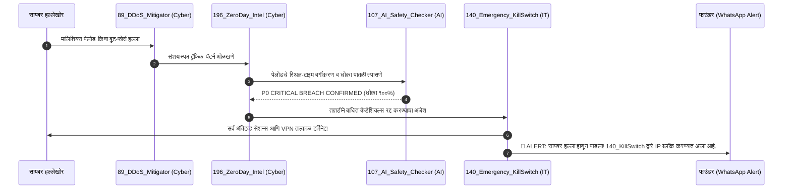
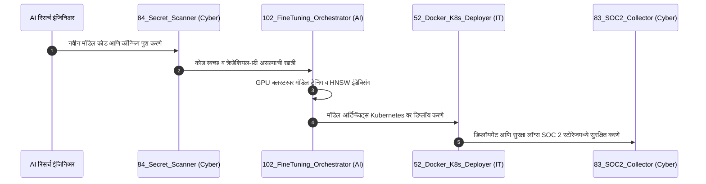

# Enterprise IT + AI + Cybersecurity - Master Triad Specification & Operations Blueprint

> **दस्तऐवज उद्देश (Purpose):** आधुनिक महाकाय टेक कंपनीचा (Enterprise Tech Titan) पाया हा **IT (इन्फॉर्मेशन टेक्नॉलॉजी)**, **AI (आर्टिफिशियल इंटेलिजन्स)**, आणि **Cybersecurity (सायबर सुरक्षा)** या तीन स्तंभांवर आधारलेला असतो. या डॉक्युमेंटमध्ये या तिन्हींचे संपूर्ण इंटिग्रेशन, ऑपरेशन्स, आणि समर्पित AI एजंट्सची सविस्तर रचना दिलेली आहे.

```
                              ┌────────────────────────────────────────┐
                              │    The Enterprise Tech Titan Triad     │
                              │          (IT + AI + CYBERSECURITY)     │
                              └───────────────────┬────────────────────┘
                                                  │
                 ┌────────────────────────────────┼────────────────────────────────┐
                 ▼                                ▼                                ▼
   ┌───────────────────────────┐    ┌───────────────────────────┐    ┌───────────────────────────┐
   │    ENTERPRISE IT & SRE    │    │      APPLIED AI & MLOPS   │    │  AUTONOMOUS CYBERSECURITY │
   │ • Zero Trust & Okta SSO   │    │ • Fine-Tuning (LoRA/QLoRA)│    │ • 24/7 AI SOC & SIEM      │
   │ • MDM Fleet Compliance    │    │ • Vector RAG & pgvector   │    │ • Zero-Day Threat Intel   │
   │ • Kubernetes & Multi-Cloud│    │ • Model Context Protocol  │    │ • DevSecOps & Secret Scan │
   │ • Disaster Recovery & RTO │    │ • Synthetic Data Gen      │    │ • SOC 2 & ISO Compliance  │
   │ • Shadow IT Discovery     │    │ • AI Safety & Guardrails  │    │ • Cloudflare WAF & DDoS   │
   └─────────────┬─────────────┘    └─────────────┬─────────────┘    └─────────────┬─────────────┘
                 │                                │                                │
                 └────────────────────────────────┼────────────────────────────────┘
                                                  │
                                                  ▼
                        ┌──────────────────────────────────────────────────┐
                        │   Unified Autonomous Defense & Innovation Mesh   │
                        │   (Agents 52-57, 83-89, 101-110, 131-140, 181-200)│
                        └──────────────────────────────────────────────────┘
```

---

## 1. स्तंभ १: Enterprise IT & Zero Trust Infrastructure (IT)

एंटरप्राइज IT चे मुख्य उद्दिष्ट कंपनीची संपूर्ण हार्डवेअर, सॉफ्टवेअर, नेटवर्किंग, आणि कर्मचारी ॲक्सेस व्यवस्था १००% सुरक्षित व स्वयंचलित ठेवणे हे आहे.

### १.१ मुख्य IT कार्यप्रणाली
1. **Identity & Access Management (IAM & SCIM):**
   - **एजंट १३१ (Okta & SAML SSO Provisioning):** नवीन कर्मचाऱ्याच्या पहिल्या दिवशी १ सेकंदात ईमेल, स्ॅक, गिटहब आणि व्हर्च्युअल डेस्कटॉप तयार करतो. राजीनामा दिल्यास १ सेकंदात सर्व ॲक्सेस बंद करतो.
   - **एजंट १३६ (FIDO2 Hardware Key Manager):** पासवर्डलेस ऑथेंटिकेशन आणि YubiKey हार्डवेअर टोकन्स सक्तीचे करतो (Anti-Phishing).
2. **Device Fleet & Endpoint Compliance (MDM):**
   - **एजंट १३२ (MDM Workstation Fleet Guard):** कंपनीच्या सर्व मॅक/विंडोज लॅपटॉप्सवर FileVault/BitLocker डिस्क एन्क्रिप्शन, OS ऑटो-अपडेट्स, आणि स्क्रीन-लॉक टाइमआउट्स सक्तीचे करतो.
   - **एजंट १३९ (IT Asset Depreciation Tracker):** लॅपटॉप वॉरंटी, लीज मुदत आणि दर ३ वर्षांनी हार्डवेअर रिप्लेसमेंट आपोआप शेड्युल करतो.
3. **क्लाउड नेटवर्किंग आणि मेश VPN:**
   - **एजंट १३४ (Zero Trust Network Access - ZTNA):** अंतर्गत सर्व्हिसेससाठी mTLS (Mutual TLS) सक्तीचे करतो. कोणताही सर्व्हर पब्लिक इंटरनेटवर उघडा राहत नाही.
   - **एजंट १३८ (Tailscale / WireGuard Mesh Guard):** एनक्रिप्टेड VPN टनेल्सचे निरीक्षण करतो आणि अनोळखी IP वरून लॉगिन झाल्यास तत्काळ अलर्ट करतो.
4. **SaaS स्पेंड व Shadow IT:**
   - **एजंट १३५ (Shadow IT Discovery Crawler):** कर्मचाऱ्यांनी अनधिकृत SaaS टूल्स वापरल्यास गुगल वर्कस्पेस लॉग्सवरून तत्काळ शोधून काढतो.
   - **एजंट १४० (Emergency Kill-Switch):** कोणतीही संशयास्पद हालचाल दिसल्यास १-क्लिकमध्ये कर्मचाऱ्याचे सर्व ॲक्टिव्ह सेशन्स, SSH कीज आणि टोकन्स रद्द करतो.

---

## 2. स्तंभ २: Applied Artificial Intelligence & Foundation MLOps (AI)

एंटरप्राइज AI चे उद्दिष्ट कंपनीच्या स्वतःच्या AI मॉडेल्सचे फाइन-ट्यूनिंग, व्हेक्टर सर्च, हॅल्युसिनेशन कंट्रोल, आणि जलद इन्फरन्स चालवणे हे आहे.

### २.१ मुख्य AI कार्यप्रणाली
1. **LLM ट्रेनिंग आणि डेटा क्युरेशन:**
   - **एजंट १०१ (Training Dataset Curation & Cleaner):** अब्जावधी टोकन्सचा डेटा डी-ड्युप्लिकेट करतो, PII माहिती गाळतो, आणि मॉडेल ट्रेनिंगसाठी स्वच्छ करतो.
   - **एजंट १०२ (LLM Fine-Tuning Job Orchestrator):** LoRA आणि QLoRA द्वारे ओपन-सोर्स मॉडेल्स (Llama-3, DeepSeek, Mistral) चे क्लाउड GPU क्लस्टरवर ऑटो-ट्रेनिंग चालवतो.
   - **एजंट १०९ (Synthetic Data Generator):** फ्रंटियर मॉडेल्सचा वापर करून विशिष्ट डोमेनसाठी उच्च दर्जाचा सिंथेटिक डेटा तयार करतो.
2. **व्हेक्टर डेटाबेस आणि RAG (Retrieval-Augmented Generation):**
   - **एजंट १०४ (Vector Embedding Index Optimizer):** PostgreSQL मधील `pgvector` आणि HNSW इंडेक्स ऑप्टिमाइझ करतो, ज्यामुळे मिलिसेकंदांत अचूक माहिती शोधता येते.
   - **एजंट १९२ (Cross-Agent Semantic Memory Bus):** सर्व २०० एजंट्सच्या अनुभवांची एक सामायिक मेमरी तयार करतो, जेणेकरून एका एजंटने शिकलेली गोष्ट सर्व एजंट्सना कळते.
3. **इन्फरन्स स्पीड आणि खर्च कपात:**
   - **एजंट १०५ (Model Inference Latency Quantizer):** AWQ / FP8 क्वांटायझेशन वापरून GPU मेमरी ५०% ने कमी करतो आणि रिस्पॉन्स स्पीड दुप्पट करतो.
   - **एजंट १०८ (GPU Spot Instance Allocator):** क्लाउडमधील स्वस्त स्पॉट GPUs वर (A100/H100) डायनॅमिक बिडिंग करून कंप्युट खर्चात ७०% बचत करतो.
   - **एजंट ११० (Prompt Cache Hit Rate Optimizer):** KV-कॅशिंग स्ट्रॅटेजी वापरून टोकन खर्च मोठ्या प्रमाणात कमी करतो.
4. **AI सुरक्षा व ॲलाइनमेंट (AI Safety & Ethics):**
   - **एजंट १०७ (Automated Hallucination Fact Checker):** मॉडेलने दिलेले उत्तर हे खरंच सत्यावर आधारित आहे की फेक (Hallucination) आहे हे लगेच तपासतो.
   - **एजंट १७० (Chief AI Ethics Officer):** EU AI Act, डेटा प्रायव्हसी, आणि कॉपीराइट कायद्यांनुसार मॉडेल सुरक्षित असल्याची खात्री करतो.

---

## 3. स्तंभ ३: Autonomous Cybersecurity, SOC & DevSecOps (Cybersecurity)

सायबर सुरक्षेचे उद्दिष्ट कंपनीवर होणारे हॅकर्सचे हल्ले, डेटा लीक, DDoS, आणि झिरो-डे धोके मानवी हस्तक्षेपाशिवाय आपोआप रोखणे हे आहे.

### ३.१ मुख्य Cybersecurity कार्यप्रणाली
1. **२४/७ ऑटोनॉमस SOC (Security Operations Center):**
   - **एजंट १९० (Executive Incident War-Room Commander):** सायबर हल्ला होताच स्वयंचलित वॉर-रूम उघडतो आणि इंजिनिअर्सना अलर्ट करतो.
   - **एजंट १९६ (Continuous Zero-Day Threat Intelligence):** डार्कनेट आणि CVE फीड्सवरून जगातील नवीन व्हायरस व झिरो-डे धोक्यांची आगाऊ माहिती मिळवतो.
2. **सॉफ्टवेअर सप्लाय चेन आणि कोड सुरक्षा (DevSecOps):**
   - **एजंट ८४ (GitHub Secret Leak Scanner):** प्रोग्रामर्सकडून चुकून गिटहब कमिटमध्ये API की किंवा पासवर्ड पुश झाल्यास सेकंदात ब्लॉक करतो.
   - **एजंट ८५ (Dependency Vulnerability Bot):** npm आणि pip पॅकेजेसमध्ये नवीन बग्स किंवा मालवेअर असल्यास आपोआप सुरक्षित पॅच PR उघडतो.
   - **एजंट १९९ (Self-Healing Code Patcher):** बग किंवा सुरक्षा त्रुटी आढळल्यास आपोआप दुरुस्त कोड लिहून टेस्टिंग करून डिप्लॉय करतो.
3. **API आणि वेब ॲप्लिकेशन डिफेन्स (OWASP & WAF):**
   - **एजंट ८६ (OWASP API Security Guard):** BOLA, IDOR, आणि SQL Injection सारख्या सर्वात घातक टॉप-१० सायबर हल्ल्यांपासून API चे रक्षण करतो.
   - **एजंट ८९ (DDoS & Bot Traffic Mitigator):** Cloudflare WAF द्वारे बॉट ट्रॅफिक आणि DDoS हल्ले रोखून फक्त खऱ्या युजर्सना प्रवेश देतो.
4. **कायदेशीर कम्प्लायन्स आणि डेटा प्रायव्हसी:**
   - **एजंट ८३ (SOC 2 & ISO 27001 Evidence Collector):** AWS CloudTrail, GitHub, आणि डेटाबेसमधून SOC 2 Type II आणि ISO 27001 चे पुरावे आपोआप गोळा करतो.
   - **एजंट ८७ (GDPR Data Deletion Request Executor):** ग्राहकाने डेटा डिलीट करायला सांगितल्यास Right-to-be-Forgotten कायद्यानुसार संपूर्ण डेटाबेस क्लीन करतो.
   - **एजंट १८९ (Immutable WORM Backup Guard):** रॅन्समवेअर हल्ल्यांपासून वाचण्यासाठी Write-Once-Read-Many (WORM) सुरक्षित बॅकअप्स राखतो.

---

## 4. तिन्ही स्तंभांची एकात्मिक ऑटोमेशन साखळी (Integrated Workflows)

### ⚡ लाइफसायकल १: सायबर हल्ला ➔ AI ॲनालिसिस ➔ IT किल-स्विच (Zero-Second Defense)


### ⚡ लाइफसायकल २: नवीन AI मॉडेल कोड ➔ DevSecOps स्कॅन ➔ IT क्लाउड डिप्लॉय


---

## 5. IT + AI + Cybersecurity चे सर्व समर्पित एजंट्स

खालील यादीमध्ये तुमच्या कंपनीतील IT, AI, आणि Cybersecurity मधील सर्व निष्णात एजंट्सची थेट फाइल लिंक्ससह माहिती दिली आहे:

### 💻 Enterprise IT & Cloud Infrastructure Agents
- [`52_devops_docker_k8s_deployer.json`](file:///c:/Users/Mr%20Shadex/Startup/09_DevOps_Cloud_Infra/52_devops_docker_k8s_deployer.json) - K8s झिरो-डाऊनटाइम डिप्लॉयर
- [`53_devops_cloud_cost_optimizer.json`](file:///c:/Users/Mr%20Shadex/Startup/09_DevOps_Cloud_Infra/53_devops_cloud_cost_optimizer.json) - क्लाउड FinOps कॉस्ट ऑप्टिमायझर
- [`54_devops_server_uptime_health_guard.json`](file:///c:/Users/Mr%20Shadex/Startup/09_DevOps_Cloud_Infra/54_devops_server_uptime_health_guard.json) - २४/७ सर्व्हर अपटाइम हेल्थगार्ड
- [`55_devops_ssl_domain_cert_renewer.json`](file:///c:/Users/Mr%20Shadex/Startup/09_DevOps_Cloud_Infra/55_devops_ssl_domain_cert_renewer.json) - झिरो-टच TLS/SSL रिन्यूअल
- [`56_devops_database_backup_verifier.json`](file:///c:/Users/Mr%20Shadex/Startup/09_DevOps_Cloud_Infra/56_devops_database_backup_verifier.json) - डेटाबेस बॅकअप व्हेरिफायर
- [`131_it_okta_saml_sso_provisioning_guard.json`](file:///c:/Users/Mr%20Shadex/Startup/19_Enterprise_IT_ZeroTrust/131_it_okta_saml_sso_provisioning_guard.json) - Okta/SAML ऑटोमॅटिक SCIM प्रोव्हिजनर
- [`132_it_mdm_device_fleet_compliance.json`](file:///c:/Users/Mr%20Shadex/Startup/19_Enterprise_IT_ZeroTrust/132_it_mdm_device_fleet_compliance.json) - MDM लॅपटॉप फ्लीट सुरक्षा
- [`134_it_internal_wifi_zerotrust_monitor.json`](file:///c:/Users/Mr%20Shadex/Startup/19_Enterprise_IT_ZeroTrust/134_it_internal_wifi_zerotrust_monitor.json) - Zero Trust ZTNA मॉनिटर
- [`136_it_passwordless_fido2_key_manager.json`](file:///c:/Users/Mr%20Shadex/Startup/19_Enterprise_IT_ZeroTrust/136_it_passwordless_fido2_key_manager.json) - FIDO2 / YubiKey मॅनेजर
- [`140_it_emergency_kill_switch_revoker.json`](file:///c:/Users/Mr%20Shadex/Startup/19_Enterprise_IT_ZeroTrust/140_it_emergency_kill_switch_revoker.json) - आपत्कालीन क्रेडेंशियल किल-स्विच
- [`161_csuite_chief_technology_officer_cto.json`](file:///c:/Users/Mr%20Shadex/Startup/22_C_Suite_Executive_Officers/161_csuite_chief_technology_officer_cto.json) - Chief Technology Officer (CTO) एजंट
- [`181_chaos_monkey_pod_failure_simulator.json`](file:///c:/Users/Mr%20Shadex/Startup/24_Chaos_Engineering_Disaster_Recovery/181_chaos_monkey_pod_failure_simulator.json) - Chaos Monkey पॉड फेल्युअर सिम्युलेटर
- [`182_chaos_multi_region_db_failover_test_runner.json`](file:///c:/Users/Mr%20Shadex/Startup/24_Chaos_Engineering_Disaster_Recovery/182_chaos_multi_region_db_failover_test_runner.json) - मल्टी-रीजन DB ऑटो-फेलओव्हर

### 🧠 Applied Artificial Intelligence & MLOps Agents
- [`101_mlops_data_curation_cleaner.json`](file:///c:/Users/Mr%20Shadex/Startup/16_AI_Research_MLOps/101_mlops_data_curation_cleaner.json) - AI डेटासेट क्युरेटर व क्लिनर
- [`102_mlops_fine_tuning_job_orchestrator.json`](file:///c:/Users/Mr%20Shadex/Startup/16_AI_Research_MLOps/102_mlops_fine_tuning_job_orchestrator.json) - LLM LoRA फाइन-ट्यूनिंग ऑर्केस्ट्रेटर
- [`103_mlops_model_eval_benchmark_runner.json`](file:///c:/Users/Mr%20Shadex/Startup/16_AI_Research_MLOps/103_mlops_model_eval_benchmark_runner.json) - मॉडेल इव्हॅल्युएशन व बेंचमार्क टेस्टर
- [`104_mlops_vector_embedding_index_optimizer.json`](file:///c:/Users/Mr%20Shadex/Startup/16_AI_Research_MLOps/104_mlops_vector_embedding_index_optimizer.json) - pgvector व्हेक्टर इंडेक्स ऑप्टिमायझर
- [`105_mlops_inference_latency_quantizer.json`](file:///c:/Users/Mr%20Shadex/Startup/16_AI_Research_MLOps/105_mlops_inference_latency_quantizer.json) - AWQ मॉडेल क्वांटायझेशन व लेटन्सी रिड्यूसर
- [`107_mlops_hallucination_fact_checker.json`](file:///c:/Users/Mr%20Shadex/Startup/16_AI_Research_MLOps/107_mlops_hallucination_fact_checker.json) - ऑटोमॅटिक हॅल्युसिनेशन फॅक्ट-चेकर
- [`108_mlops_gpu_cluster_spot_instance_allocator.json`](file:///c:/Users/Mr%20Shadex/Startup/16_AI_Research_MLOps/108_mlops_gpu_cluster_spot_instance_allocator.json) - स्पॉट GPU बिडर (७०% कंप्युट बचत)
- [`109_mlops_synthetic_data_generator.json`](file:///c:/Users/Mr%20Shadex/Startup/16_AI_Research_MLOps/109_mlops_synthetic_data_generator.json) - सिंथेटिक डेटा जनरेटर
- [`170_csuite_chief_ai_ethics_officer.json`](file:///c:/Users/Mr%20Shadex/Startup/22_C_Suite_Executive_Officers/170_csuite_chief_ai_ethics_officer.json) - Chief AI Ethics & Governance Officer
- [`192_titan_cross_agent_memory_sync_bus.json`](file:///c:/Users/Mr%20Shadex/Startup/24_Chaos_Engineering_Disaster_Recovery/192_titan_cross_agent_memory_sync_bus.json) - क्रॉस-एजंट सेमेंटिक मेमरी बस

### 🛡️ Autonomous Cybersecurity & SOC Agents
- [`83_sec_soc2_iso27001_evidence_collector.json`](file:///c:/Users/Mr%20Shadex/Startup/14_Cybersecurity_Compliance/83_sec_soc2_iso27001_evidence_collector.json) - SOC 2 / ISO 27001 ऑटो-कम्प्लायन्स
- [`84_sec_github_secrets_leak_scanner.json`](file:///c:/Users/Mr%20Shadex/Startup/14_Cybersecurity_Compliance/84_sec_github_secrets_leak_scanner.json) - गिटहब सिक्रेट व टोकन लीक स्कॅनर
- [`85_sec_npm_pip_dependency_vulnerability_bot.json`](file:///c:/Users/Mr%20Shadex/Startup/14_Cybersecurity_Compliance/85_sec_npm_pip_dependency_vulnerability_bot.json) - npm/pip डिपेंडन्सी CVE स्कॅनर
- [`86_sec_owasp_api_security_guard.json`](file:///c:/Users/Mr%20Shadex/Startup/14_Cybersecurity_Compliance/86_sec_owasp_api_security_guard.json) - OWASP API BOLA/IDOR डिफेन्डर
- [`87_sec_gdpr_data_deletion_request_executor.json`](file:///c:/Users/Mr%20Shadex/Startup/14_Cybersecurity_Compliance/87_sec_gdpr_data_deletion_request_executor.json) - GDPR / CCPA राईट-टू-बी-फॉरगॉटन
- [`88_sec_internal_rbac_access_reviewer.json`](file:///c:/Users/Mr%20Shadex/Startup/14_Cybersecurity_Compliance/88_sec_internal_rbac_access_reviewer.json) - अंतर्गत RBAC परमिशन ऑडिटर
- [`89_sec_ddos_bot_traffic_mitigator.json`](file:///c:/Users/Mr%20Shadex/Startup/14_Cybersecurity_Compliance/89_sec_ddos_bot_traffic_mitigator.json) - Cloudflare WAF व DDoS डिफेन्डर
- [`133_it_phishing_simulation_training_bot.json`](file:///c:/Users/Mr%20Shadex/Startup/19_Enterprise_IT_ZeroTrust/133_it_phishing_simulation_training_bot.json) - फिशिंग सिम्युलेशन व ट्रेनिंग बॉट
- [`165_csuite_chief_information_security_officer_ciso.json`](file:///c:/Users/Mr%20Shadex/Startup/22_C_Suite_Executive_Officers/165_csuite_chief_information_security_officer_ciso.json) - Chief Information Security Officer (CISO) एजंट
- [`189_chaos_ransomware_immutable_backup_guard.json`](file:///c:/Users/Mr%20Shadex/Startup/24_Chaos_Engineering_Disaster_Recovery/189_chaos_ransomware_immutable_backup_guard.json) - रॅन्समवेअर-प्रूफ इम्युटेबल बॅकअप
- [`190_chaos_executive_war_room_commander.json`](file:///c:/Users/Mr%20Shadex/Startup/24_Chaos_Engineering_Disaster_Recovery/190_chaos_executive_war_room_commander.json) - सायबर इन्सिडेंट वॉर-रूम कमांडर
- [`196_titan_continuous_zero_day_threat_intel.json`](file:///c:/Users/Mr%20Shadex/Startup/24_Chaos_Engineering_Disaster_Recovery/196_titan_continuous_zero_day_threat_intel.json) - २४/७ झिरो-डे थेट इंटेलिजन्स स्काउट
- [`199_titan_self_healing_code_patcher.json`](file:///c:/Users/Mr%20Shadex/Startup/24_Chaos_Engineering_Disaster_Recovery/199_titan_self_healing_code_patcher.json) - सेल्फ-हीलिंग ऑटोमॅटिक सिक्युरिटी पॅचर

