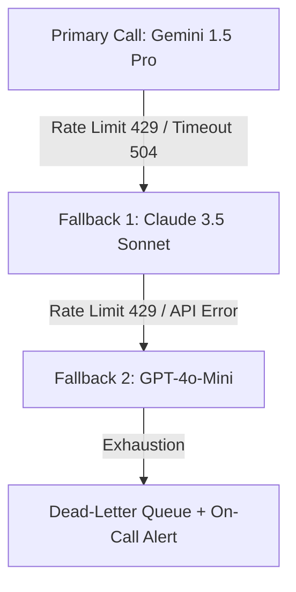

# Tech Startup Platform - Comprehensive Debugging & Diagnostics Guide

## 1. Overview & Observability Architecture

This guide provides end-to-end debugging procedures, diagnostics runbooks, and failure recovery policies for the Tech Startup Autonomous Platform (100 AI Agents across 15 operational departments).

```
[Inbound Event / Webhook] 
       │
       ▼
[Cloudflare WAF / API Gateway] ──(Trace ID Injection)
       │
       ▼
[00_whatsapp_master_router] ──► [Redis Queue / BullMQ]
       │                                │
       ▼                                ▼
[Department Workflows 01-99] ◄── [Worker Pool]
       │
       ├──► [OpenTelemetry Tracing] ──► Jaeger / Grafana Tempo
       ├──► [Sentry Exception Trap] ──► Sentry Alerts / On-Call
       └──► [PostgreSQL & Vector DB] ──► Audit Logs & Rollbacks
```

---

## 2. Distributed Tracing & Correlation IDs

Every inbound webhook, API request, and agent dispatch MUST carry a unified `x-request-id` / `trace-id`.

### Propagation Rules
1. **Header Name**: `X-Correlation-ID` or `X-Request-ID`.
2. **Format**: UUIDv4 (`f81d4fae-7dec-11d0-a765-00a0c91e6bf6`).
3. **Propagation Path**:
   `Client / Webhook` ➔ `Master Router (00)` ➔ `n8n Sub-Workflow` ➔ `LLM Prompt Metadata` ➔ `Database Audit Log`.

### Node.js / n8n Expression for Context Propagation:
```javascript
// Extract or initialize correlation ID
const correlationId = $input.item.json.headers['x-correlation-id'] || 
                      $input.item.json.headers['x-request-id'] || 
                      `req_${Date.now()}_${Math.random().toString(36).substr(2, 9)}`;

return {
  json: {
    ...$input.item.json,
    correlationId: correlationId,
    timestamp: new Date().toISOString()
  }
};
```

---

## 3. n8n Workflow Execution Debugging

### 3.1 Common Workflow Failure Modes

| Failure Category | Symptom | Root Cause | Resolution |
|---|---|---|---|
| **Webhook Timeout** | HTTP 504 Gateway Timeout | Workflow processing synchronously exceeds 30s | Switch webhook response mode to `Respond Immediately: 202 Accepted` and offload tasks to background sub-workflows. |
| **Node JSON Schema Mismatch** | `Cannot read property 'x' of undefined` | Upstream API payload schema changed or null payload | Insert a Code Node with defensive validation (`item?.data?.x ?? defaultValue`). |
| **Memory Exhaustion (OOM)** | n8n process crashes / restarts | Processing large JSON arrays (10,000+ items) in a single node | Chunk items using the `Split In Batches` node (batch size: 50-100). |
| **Database Lock Wait** | Postgres error `canceling statement due to statement timeout` | Unindexed queries or concurrent writes in high-frequency webhooks | Wrap writes in atomic queue workers with rate limits. |

### 3.2 Inspecting Failed Executions
1. Open n8n Admin UI: `http://localhost:5678/workflow/executions`
2. Filter by:
   - **Status**: `Failed`
   - **Workflow ID**: E.g., `100_tech_startup_autonomous_master_workflow`
3. Click on the red failed node to examine:
   - **Input Data**: Exact JSON sent to the node.
   - **Error Stack**: Node execution error trace.
   - **Output Data**: Partial output before termination.

---

## 4. LLM Token, Rate Limit & Fallback Policies

When orchestrating 100 AI agents calling Gemini, Anthropic, or OpenAI APIs, rate limits and context overflows are the primary failure modes.

### 4.1 Fallback Hierarchy



### 4.2 Handling 429 (Too Many Requests) & Exponential Backoff
Implement jittered exponential backoff in API calls:
```javascript
async function callLLMWithRetry(fn, maxRetries = 4, baseDelay = 1000) {
  for (let attempt = 1; attempt <= maxRetries; attempt++) {
    try {
      return await fn();
    } catch (err) {
      const isRateLimit = err.status === 429 || (err.message && err.message.includes('429'));
      if (!isRateLimit || attempt === maxRetries) {
        throw err;
      }
      // Calculate jittered exponential backoff
      const jitter = Math.random() * 200;
      const delay = Math.pow(2, attempt) * baseDelay + jitter;
      console.warn(`[LLM Rate Limit] Retrying attempt ${attempt}/${maxRetries} after ${Math.round(delay)}ms...`);
      await new Promise(res => setTimeout(res, delay));
    }
  }
}
```

### 4.3 Context Window Overflow Truncation
If conversation context exceeds the token limit:
1. Retain the **System Prompt** and **Tool Definitions**.
2. Retain the **Last 4 User/Assistant Interactions**.
3. Compact older messages into an LLM-generated summary (`summary_buffer_memory`).

---

## 5. Webhook Dead-Letter Queues (DLQ) & Resilience

Any webhook that fails 3 consecutive delivery attempts is routed into a PostgreSQL/Redis Dead-Letter Queue.

### DLQ Schema:
```sql
CREATE TABLE webhook_dead_letter_queue (
    id UUID PRIMARY KEY DEFAULT gen_random_uuid(),
    correlation_id VARCHAR(64) NOT NULL,
    source_service VARCHAR(50) NOT NULL,
    target_workflow VARCHAR(100) NOT NULL,
    payload JSONB NOT NULL,
    error_message TEXT,
    retry_count INT DEFAULT 0,
    status VARCHAR(20) DEFAULT 'FAILED', -- 'FAILED', 'REPLAYING', 'RESOLVED'
    created_at TIMESTAMP WITH TIME ZONE DEFAULT NOW(),
    updated_at TIMESTAMP WITH TIME ZONE DEFAULT NOW()
);
```

### DLQ Replay CLI:
```bash
# Replay failed webhooks from the past 2 hours
node scripts/replay_dlq.js --hours=2 --workflow=00_whatsapp_master_router
```

---

## 6. Sentry Exception Triage & Alerts

All agent microservices and code nodes report fatal exceptions to Sentry:

```javascript
const Sentry = require('@sentry/node');

Sentry.init({
  dsn: process.env.SENTRY_DSN,
  environment: process.env.NODE_ENV || 'production',
  tracesSampleRate: 0.2
});

function captureAgentException(agentId, error, context) {
  Sentry.withScope((scope) => {
    scope.setTag('agent_id', agentId);
    scope.setExtra('context', context);
    Sentry.captureException(error);
  });
}
```

### Alert Triage Thresholds:
- **P0 Critical Alert (PagerDuty + WhatsApp to CTO)**:
  - Agent 00 (Master Router) down > 60 seconds.
  - Agent 64 (Stripe Billing) charge failures > 5% of requests.
  - Agent 83 (Vulnerability & Threat Shield) flags active breach attempts.
- **P1 High Alert (Slack #alerts-engineering)**:
  - Agent execution failure rate > 2% over 15 minutes.
  - LLM fallback cascade triggered > 10 times per hour.
- **P2 Low Alert (Daily Digest)**:
  - Lead enrichment failures for cold leads.
  - Non-critical telemetry logging timeouts.

---

## 7. Diagnostic CLI & Healthchecks

### System Healthcheck Endpoint:
`GET /healthz`

```json
{
  "status": "healthy",
  "version": "2.4.0",
  "uptime_seconds": 86420,
  "checks": {
    "database_postgres": "UP (12ms)",
    "cache_redis": "UP (2ms)",
    "n8n_master_engine": "UP (15ms)",
    "llm_gemini_api": "UP (180ms)",
    "stripe_webhook_listener": "UP"
  },
  "queue_backlog": {
    "pending_jobs": 4,
    "active_workers": 12,
    "dlq_count": 0
  }
}
```

### Self-Diagnostics Command:
Run the internal diagnostics sweep:
```bash
npm run test:diagnostics
# Checks database connections, environment variables, API token quotas, and file descriptors.
```

