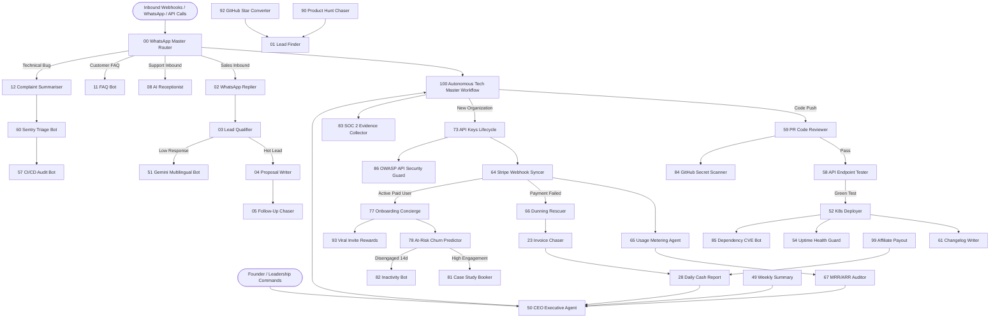

# Enterprise Tech Titan Platform - Complete 200 AI Agents Tree & Architecture Map

## 1. Executive Master Directory Tree

```
c:\Users\Mr Shadex\Startup\
│
├── 🏛️ Master Orchestrators & Executive Gateways (Root Level)
│   ├── 00_SUPREME_ENTERPRISE_TITAN_CONNECTED_CANVAS.json [Supreme Master Canvas: All 24 Departments & 200 Agents Wired]
│   ├── 00_whatsapp_master_router.json               [Agent 00: Central Inbound Meta Cloud Router]
│   ├── 00_BONUS_first_12_connected_one_canvas.json  [Agent 00: Visual Unified 12-Agent Canvas]
│   ├── 50_ceo_agent.json                            [Agent 50: CEO Executive Assistant & Orchestrator]
│   └── 100_tech_startup_autonomous_master_workflow.json [Agent 100: End-to-End Tech Startup Engine]
│
├── 📚 Comprehensive System Documentation (Production Grade)
│   ├── AGENTS.md                                    [Directory of all 100 AI Agents across 15 Departments]
│   ├── API.md                                       [REST, GraphQL, Webhook Schemas, Rate Limits & Errors]
│   ├── ARCHITECTURE.md                              [End-to-End System Architecture, Topology & Mermaid Maps]
│   ├── auth.md                                      [JWT Lifecycle, API Keys, RBAC Matrix & HMAC Security]
│   ├── COMPANY_PLAYBOOK.md                          [Master Founder Blueprint: How to Start, Run & Scale from Day 0]
│   ├── DATABASE.md                                  [PostgreSQL 16 Schema, Redis Cache Keys & Data Bus]
│   ├── debugging.md                                 [Diagnostics, Sentry Trap, DLQ & LLM Fallback Policies]
│   ├── Decisions.md                                 [Architectural Decision Records (ADRs) & Trade-offs]
│   ├── DESIGN.md                                    [System Design, Tailwind UI Tokens & Scalability]
│   ├── FEATURES.md                                  [Feature Matrix, Real-World User Flows & Plan Tiers]
│   ├── integrations.md                              [Third-Party Service Integration Contracts]
│   ├── IT_AI_CYBERSECURITY.md                       [The Master Triad: Enterprise IT, Applied AI & Autonomous Cybersecurity]
│   ├── MAP3_Setup_Guide.pdf                         [Visual Illustrated Enterprise Setup Manual]
│   ├── mcp.md                                       [Model Context Protocol (MCP JSON-RPC) Specification]
│   ├── PLAN.md                                      [Execution Roadmap, Milestones & Sprint Plans]
│   ├── PRD.md                                       [Product Requirements Document for Tech Startup]
│   ├── README.md                                    [Quickstart Onboarding, Installation & Environment Guide]
│   ├── SETUP.md                                     [Step-by-Step Production Deployment Manual]
│   ├── testing.md                                   [QA Test Pyramid: Playwright, Newman & k6 Load Tests]
│   └── tree.md                                      [This Complete Master Tree & Connectivity Catalog]
│
├── 📁 01_Sales/                                     [Department 01: B2B Sales & Pipeline Intelligence]
│   ├── 01_sales_lead_finder.json                    [Agent 01: Automated B2B Lead Scraping & Prospecting]
│   ├── 02_sales_whatsapp_replier.json               [Agent 02: Instant Sub-Second WhatsApp Auto-Replier]
│   ├── 03_sales_lead_qualifier.json                 [Agent 03: Lead Scoring & BANT Qualification Engine]
│   ├── 04_sales_proposal_writer.json                [Agent 04: Dynamic SaaS Proposal & Contract Generator]
│   ├── 05_sales_follow_up_chaser.json               [Agent 05: Day 1, 3, 7 Multichannel Follow-Up Engine]
│   ├── 06_sales_repeat_order_reminder.json          [Agent 06: SaaS License Renewal & Upsell Reminder]
│   ├── 07_sales_referral_asker.json                 [Agent 07: Customer Review & Referral Incentive Asker]
│   └── 51_sales_whatsapp_gemini_lead_bot.json       [Agent 51: Multilingual (EN/HI/MR) Gemini Flash Lead Bot]
│
├── 📁 02_Support/                                   [Department 02: Omnichannel Support & Helpdesk]
│   ├── 08_support_ai_receptionist.json              [Agent 08: 24/7 Calendar Demo & Meeting Scheduler]
│   ├── 09_support_missed_call_rescuer.json          [Agent 09: Instant WhatsApp SMS for Missed Calls]
│   ├── 10_support_inbox_sorter.json                 [Agent 10: Email Inbox Classifier (Urgent/FYI)]
│   ├── 11_support_faq_bot.json                      [Agent 11: Vector RAG Knowledge Base Technical FAQ Bot]
│   ├── 12_support_complaint_summariser.json         [Agent 12: Incident Logger & P0 Urgent Escalator]
│   ├── 13_support_queue_wait_alert.json             [Agent 13: Live Support Queue Position & Wait Alert]
│   └── 14_support_feedback_follow_up.json           [Agent 14: 24h Post-Resolution CSAT Satisfaction Audit]
│
├── 📁 03_Marketing/                                 [Department 03: Marketing, SEO & Content Engine]
│   ├── 15_marketing_seo_page_team.json              [Agent 15: Competitor Keyword Gap & SEO Blog Writer]
│   ├── 16_marketing_1_video_to_5_posts.json         [Agent 16: Video to LinkedIn, X, Shorts & Newsletter]
│   ├── 17_marketing_review_replier.json             [Agent 17: Google, G2 & Capterra Review Replier]
│   ├── 18_marketing_review_asker.json               [Agent 18: Post-Delivery Product Hunt & G2 Review Asker]
│   ├── 19_marketing_comment_replier.json            [Agent 19: Social Community Comment Replier]
│   ├── 20_marketing_festival_offer_broadcaster.json [Agent 20: Broadcast Campaign & Promo Copywriter]
│   └── 21_marketing_product_description_writer.json [Agent 21: App Store & Changelog Copywriter]
│
├── 📁 04_Finance/                                   [Department 04: Finance, Cash Flow & Accounting]
│   ├── 22_finance_bill_reader.json                  [Agent 22: OCR Receipt & Vendor Invoice Extractor]
│   ├── 23_finance_invoice_chaser.json               [Agent 23: Accounts Receivable Overdue Invoice Chaser]
│   ├── 24_finance_bank_statement_reader.json        [Agent 24: Bank PDF Statement & Ledger Reconciliation]
│   ├── 25_finance_invoice_to_gst_register.json      [Agent 25: GST, VAT & Tax-Filing Compliant Formatter]
│   ├── 26_finance_fee_reminder.json                 [Agent 26: Dynamic UPI, Wire & Stripe Checkout Sender]
│   ├── 27_finance_expense_categoriser.json          [Agent 27: Employee Expense & Policy Compliance Auditor]
│   └── 28_finance_daily_cash_report.json            [Agent 28: 9 PM Daily Financial Executive Briefing]
│
├── 📁 05_HR/                                        [Department 05: Talent Acquisition, HR & Culture]
│   ├── 29_hr_resume_screener.json                   [Agent 29: AI Technical Resume Screener & Scorer]
│   ├── 30_hr_interview_scheduler.json               [Agent 30: Automated Engineering Interview Coordinator]
│   ├── 31_hr_offer_letter_writer.json               [Agent 31: Formatted PDF Offer Letter Generator]
│   ├── 32_hr_onboarding_buddy.json                  [Agent 32: Day 1 to 7 New Hire Onboarding Guide]
│   ├── 33_hr_leave_bot.json                         [Agent 33: PTO & Leave Manager with 1-Click Approvals]
│   ├── 34_hr_employee_doc_collector.json            [Agent 34: KYC & Identity Document Verification]
│   └── 35_hr_payslip_sender.json                    [Agent 35: Monthly Salary Slip & Tax Form Dispatcher]
│
├── 📁 06_Operations/                                [Department 06: Operations, Tasks & Milestone Radar]
│   ├── 36_ops_no_show_stopper.json                  [Agent 36: 2-Hour Pre-Meeting WhatsApp Confirmation]
│   ├── 37_ops_deadline_alert.json                   [Agent 37: 24-Hour Critical Milestone & Task Radar]
│   ├── 38_ops_document_chaser.json                  [Agent 38: Unsigned Vendor NDA & Agreement Chaser]
│   ├── 39_ops_stock_alert.json                      [Agent 39: Software Seat & Hardware Threshold Alert]
│   ├── 40_ops_vendor_po_sender.json                 [Agent 40: Vendor Purchase Order & Cloud Invoice Sender]
│   ├── 41_ops_delivery_status_updater.json          [Agent 41: Enterprise Client Milestone Delivery Bot]
│   └── 42_ops_daily_task_assigner.json              [Agent 42: 8:30 AM Morning Team Task Assigner]
│
├── 📁 07_Research/                                  [Department 07: Market Intelligence & Research]
│   ├── 43_research_competitor_watcher.json          [Agent 43: Competitor Pricing & Feature Rollout Radar]
│   ├── 44_research_price_tracker.json               [Agent 44: GPU & Cloud Compute Pricing Benchmark]
│   ├── 45_research_news_digest.json                 [Agent 45: 7:00 AM Curated Tech & AI Industry Digest]
│   ├── 46_research_pdf_summariser.json              [Agent 46: Academic Paper & Whitepaper Summarizer]
│   ├── 47_research_lead_researcher.json             [Agent 47: Target Enterprise Prospect Battlecard Builder]
│   ├── 48_research_meeting_notes.json               [Agent 48: Meeting Audio to Jira Action Item Extractor]
│   └── 49_research_weekly_summary.json              [Agent 49: Friday 6:00 PM 1-Page Company Briefing]
│
├── 📁 09_DevOps_Cloud_Infra/                        [Department 09: DevOps, Cloud Infra & SRE]
│   ├── 52_devops_docker_k8s_deployer.json           [Agent 52: Container Build & K8s Rolling Deployer]
│   ├── 53_devops_cloud_cost_optimizer.json          [Agent 53: Multi-Cloud FinOps & Idle Compute Pruner]
│   ├── 54_devops_server_uptime_health_guard.json    [Agent 54: HTTP/TCP Synthetic Healthcheck & Failover]
│   ├── 55_devops_ssl_domain_cert_renewer.json       [Agent 55: Let's Encrypt / TLS Zero-Touch Renewal]
│   ├── 56_devops_database_backup_verifier.json      [Agent 56: Nightly DB Backup Verification & Dry-Run]
│   └── 57_devops_ci_cd_pipeline_audit_bot.json      [Agent 57: GitHub Actions Failure Healer & Fix Suggester]
│
├── 📁 10_Product_Engineering_QA/                    [Department 10: Product Engineering & QA]
│   ├── 58_qa_automated_api_endpoint_tester.json     [Agent 58: Postman / Newman API Endpoint Tester]
│   ├── 59_qa_github_pr_code_reviewer.json           [Agent 59: Automated AST & LLM PR Code Reviewer]
│   ├── 60_qa_sentry_error_triage_bot.json           [Agent 60: Sentry Error Aggregator & Jira Ticket Bot]
│   ├── 61_product_changelog_release_writer.json     [Agent 61: Git Commits to Product Release Notes]
│   ├── 62_product_feature_flag_evaluator.json       [Agent 62: LaunchDarkly / PostHog Feature Flag Auditor]
│   └── 63_product_user_feedback_categoriser.json    [Agent 63: User Feedback to Roadmap Feature Requests]
│
├── 📁 11_SaaS_Billing_Stripe_Usage/                 [Department 11: SaaS Billing, Stripe & Usage Metering]
│   ├── 64_saas_stripe_webhook_syncer.json           [Agent 64: Stripe Real-Time Event & Checkout Syncer]
│   ├── 65_saas_usage_metering_billing_agent.json    [Agent 65: High-Throughput API Metered Invoicing]
│   ├── 66_saas_dunning_failed_payment_rescuer.json  [Agent 66: Automated Dunning & Smart Payment Retrier]
│   ├── 67_saas_mrr_arr_churn_financial_auditor.json [Agent 67: Real-Time MRR, ARR, NRR & Churn Auditor]
│   ├── 68_saas_annual_plan_upgrade_pitcher.json     [Agent 68: Annual Discount Plan Conversion Pitcher]
│   ├── 69_saas_free_trial_to_paid_converter.json    [Agent 69: Day 10 Free-Trial to Paid Converter]
│   └── 70_saas_enterprise_custom_pricing_calculator.json [Agent 70: Enterprise Custom Volume Quote Calculator]
│
├── 📁 12_API_MCP_Integrations/                      [Department 12: API, MCP & Integrations Ecosystem]
│   ├── 71_mcp_server_registry_router.json           [Agent 71: Model Context Protocol (MCP) Gateway Router]
│   ├── 72_api_rate_limit_throttle_protector.json    [Agent 72: Redis Token Bucket Rate Limiting Protector]
│   ├── 73_api_developer_keys_lifecycle_manager.json [Agent 73: Developer API Key Issuance & Secret Rotation]
│   ├── 74_api_webhook_outbound_retry_dispatcher.json [Agent 74: HMAC Webhook Delivery & Exponential Retry]
│   ├── 75_api_openapi_swagger_spec_generator.json   [Agent 75: Interactive OpenAPI 3.1 Spec Generator]
│   └── 76_api_third_party_oauth_token_refresher.json [Agent 76: OAuth2 Access Token Auto-Refresh Manager]
│
├── 📁 13_Customer_Success_Product/                  [Department 13: Customer Success, Retention & Analytics]
│   ├── 77_cs_new_user_onboarding_concierge.json     [Agent 77: Interactive Tour & Setup Checklist Guide]
│   ├── 78_cs_at_risk_churn_predictor.json           [Agent 78: Inactivity & Disengagement Churn Predictor]
│   ├── 79_cs_automated_nps_csat_collector.json     [Agent 79: Automated NPS Collector & Detractor Router]
│   ├── 80_cs_vip_account_support_sla_guard.json     [Agent 80: Enterprise VIP <15 Min SLA Queue Guard]
│   ├── 81_cs_customer_case_study_interview_booker.json [Agent 81: Power User Testimonial & Case Study Booker]
│   └── 82_cs_inactivity_re_engagement_bot.json      [Agent 82: 14-Day Dormant Account Re-Engagement Bot]
│
├── 📁 14_Cybersecurity_Compliance/                  [Department 14: Cybersecurity, Zero Trust & Compliance]
│   ├── 83_sec_soc2_iso27001_evidence_collector.json [Agent 83: Continuous SOC 2 / ISO Compliance Evidence]
│   ├── 84_sec_github_secrets_leak_scanner.json      [Agent 84: Commits & PRs Private Key Leak Scanner]
│   ├── 85_sec_npm_pip_dependency_vulnerability_bot.json [Agent 85: npm/pip Dependency CVE Vulnerability Bot]
│   ├── 86_sec_owasp_api_security_guard.json         [Agent 86: OWASP Top 10 API Threat & BOLA Guard]
│   ├── 87_sec_gdpr_data_deletion_request_executor.json [Agent 87: GDPR / CCPA Right-to-be-Forgotten Purger]
│   ├── 88_sec_internal_rbac_access_reviewer.json    [Agent 88: Monthly Cloud & Database Permission Auditor]
│   └── 89_sec_ddos_bot_traffic_mitigator.json       [Agent 89: Cloudflare WAF Dynamic Threat Mitigator]
│
└── 📁 15_Growth_PLG_Virality/                       [Department 15: Growth Engineering & Product Virality]
    ├── 90_growth_product_hunt_launch_chaser.json    [Agent 90: Product Hunt & Hacker News Launch Chaser]
    ├── 91_growth_developer_docs_seo_optimizer.json  [Agent 91: Developer Documentation Schema SEO Optimizer]
    ├── 92_growth_github_star_to_lead_converter.json [Agent 92: OSS Repository Stargazer Lead Outreach]
    ├── 93_growth_viral_invite_referral_rewards.json [Agent 93: Viral Colleague Workspace Invite Rewards]
    ├── 94_growth_hacker_news_reddit_trend_scout.json [Agent 94: Developer Forum Trend & Opportunity Scout]
    ├── 95_growth_interactive_demo_sandbox_provisioner.json [Agent 95: Instant 1-Click Interactive Demo Sandbox]
    ├── 96_growth_linkedin_thought_leadership_bot.json [Agent 96: Engineering Architecture Thought Leadership]
    ├── 97_growth_competitor_feature_matrix_tracker.json [Agent 97: "Alternative To" Competitive Comparison]
    ├── 98_growth_automated_podcast_transcript_repurposer.json [Agent 98: Tech Podcast to Thread & Blog Repurposer]
    ├── 99_growth_affiliate_partner_commission_payout.json [Agent 99: Affiliate Referral Tracking & Stripe Payout]
│
├── 📁 16_AI_Research_MLOps/                         [Department 16: AI Research, LLM Training & MLOps]
│   ├── 101_mlops_data_curation_cleaner.json         [Agent 101: AI Training Dataset Curation & Cleaner]
│   ├── 102_mlops_fine_tuning_job_orchestrator.json  [Agent 102: LLM Fine-Tuning Job Orchestrator]
│   ├── 103_mlops_model_eval_benchmark_runner.json   [Agent 103: Model Evaluation & Benchmark Runner]
│   ├── 104_mlops_vector_embedding_index_optimizer.json [Agent 104: Vector Embedding Index Optimizer]
│   ├── 105_mlops_inference_latency_quantizer.json   [Agent 105: Model Inference Latency Quantizer]
│   ├── 106_mlops_rlhf_reward_model_scorer.json      [Agent 106: RLHF & Preference Reward Scorer]
│   ├── 107_mlops_hallucination_fact_checker.json    [Agent 107: Automated Hallucination Fact Checker]
│   ├── 108_mlops_gpu_cluster_spot_instance_allocator.json [Agent 108: GPU Cluster Spot Instance Allocator]
│   ├── 109_mlops_synthetic_data_generator.json      [Agent 109: Synthetic Training Data Generator]
│   └── 110_mlops_prompt_cache_hit_rate_optimizer.json [Agent 110: Prompt Cache Hit Rate Optimizer]
│
├── 📁 17_Legal_Patents_Contracts/                   [Department 17: Legal, Patents & Enterprise Contracts]
│   ├── 111_legal_enterprise_msa_redline_auditor.json [Agent 111: Enterprise MSA Redline Contract Auditor]
│   ├── 112_legal_nda_mutual_compliance_bot.json     [Agent 112: Instant NDA Generation & Review Bot]
│   ├── 113_legal_patent_prior_art_scout.json        [Agent 113: Patent Prior Art Scout & Drafter]
│   ├── 114_legal_trademark_brand_infringement_crawler.json [Agent 114: Trademark & Brand Infringement Crawler]
│   ├── 115_legal_open_source_license_compliance.json [Agent 115: Open Source License Compliance Guard]
│   ├── 116_legal_gdpr_dpa_vendor_auditor.json       [Agent 116: GDPR / DPA Vendor Agreement Auditor]
│   ├── 117_legal_terms_of_service_diff_notifier.json [Agent 117: Terms of Service Diff & Update Notifier]
│   ├── 118_legal_whistleblower_confidential_triage.json [Agent 118: Whistleblower Confidential Portal Triage]
│   ├── 119_legal_esg_sustainability_reporter.json   [Agent 119: ESG & Corporate Sustainability Reporter]
│   └── 120_legal_ip_assignment_audit_bot.json       [Agent 120: Contractor IP Assignment Audit Bot]
│
├── 📁 18_Data_Engineering_Lakehouse/                [Department 18: Data Engineering, Analytics & Lakehouse]
│   ├── 121_data_etl_pipeline_health_guardian.json   [Agent 121: ETL Pipeline Health Guardian]
│   ├── 122_data_dbt_model_test_and_docs_bot.json    [Agent 122: dbt Data Model Test & Docs Bot]
│   ├── 123_data_bigquery_snowflake_cost_sentinel.json [Agent 123: BigQuery & Snowflake Cost Sentinel]
│   ├── 124_data_metric_anomaly_detector.json        [Agent 124: Real-Time Metric Anomaly Detector]
│   ├── 125_data_cdc_stream_replication_checker.json [Agent 125: Change Data Capture (CDC) Stream Checker]
│   ├── 126_data_governance_pii_tagger.json          [Agent 126: Data Catalog & PII Column Tagger]
│   ├── 127_data_customer_360_identity_stitcher.json [Agent 127: Customer 360 Identity Stitcher]
│   ├── 128_data_reverse_etl_crm_syncer.json         [Agent 128: Reverse ETL Product Usage to CRM Syncer]
│   ├── 129_data_automated_data_retention_purger.json [Agent 129: Automated Data Retention Policy Purger]
│   └── 130_data_parquet_iceberg_compactor.json      [Agent 130: Apache Iceberg / Parquet File Compactor]
│
├── 📁 19_Enterprise_IT_ZeroTrust/                   [Department 19: Enterprise IT, Identity & Zero Trust]
│   ├── 131_it_okta_saml_sso_provisioning_guard.json [Agent 131: Okta & SAML SSO Provisioning Guard]
│   ├── 132_it_mdm_device_fleet_compliance.json      [Agent 132: MDM Workstation Fleet Compliance Guard]
│   ├── 133_it_phishing_simulation_training_bot.json [Agent 133: Phishing Simulation & Security Trainer]
│   ├── 134_it_internal_wifi_zerotrust_monitor.json  [Agent 134: Zero Trust Network Access (ZTNA) Monitor]
│   ├── 135_it_shadow_it_saas_discovery_crawler.json [Agent 135: Shadow IT SaaS Discovery Crawler]
│   ├── 136_it_passwordless_fido2_key_manager.json   [Agent 136: FIDO2 / Hardware Security Key Manager]
│   ├── 137_it_slack_google_workspace_provisioner.json [Agent 137: Slack & Email Auto-Provisioner]
│   ├── 138_it_vpn_tailscale_mesh_traffic_guard.json [Agent 138: Tailscale / WireGuard Mesh Traffic Guard]
│   ├── 139_it_asset_hardware_depreciation_tracker.json [Agent 139: IT Asset Lifecycle & Depreciation Tracker]
│   └── 140_it_emergency_kill_switch_revoker.json    [Agent 140: Instant Emergency Credential Kill-Switch]
│
├── 📁 20_Product_Management_Strategy/               [Department 20: Product Management, Strategy & Roadmap]
│   ├── 141_pm_spec_and_prd_generator.json           [Agent 141: Automated PRD & Feature Spec Generator]
│   ├── 142_pm_rice_feature_scoring_prioritizer.json [Agent 142: RICE Feature Scoring Prioritizer]
│   ├── 143_pm_customer_interview_synthesizer.json   [Agent 143: Customer User Interview Synthesizer]
│   ├── 144_pm_telemetry_cohort_funnel_analyzer.json [Agent 144: Product Telemetry Cohort Funnel Analyzer]
│   ├── 145_pm_release_train_readiness_coordinator.json [Agent 145: Release Train Readiness Coordinator]
│   ├── 146_pm_competitive_teardown_reporter.json    [Agent 146: Competitive Teardown & Benchmarking Bot]
│   ├── 147_pm_feature_sunset_deprecation_planner.json [Agent 147: Feature Sunset & Deprecation Planner]
│   ├── 148_pm_in_app_micro_survey_trigger.json      [Agent 148: In-App Micro Survey Context Trigger]
│   ├── 149_pm_roadmap_public_portal_syncer.json     [Agent 149: Public Roadmap & Feature Upvote Syncer]
│   └── 150_pm_pricing_packaging_experimenter.json   [Agent 150: Pricing & Packaging Experiment Planner]
│
├── 📁 21_Investor_Relations_M_and_A/                [Department 21: Investor Relations, M&A & Board Governance]
│   ├── 151_ir_cap_table_option_pool_auditor.json    [Agent 151: Cap Table & Stock Option Pool Auditor]
│   ├── 152_ir_monthly_investor_update_drafter.json  [Agent 152: Monthly Investor Update Email Drafter]
│   ├── 153_ir_board_meeting_deck_generator.json     [Agent 153: Quarterly Board Meeting Deck Generator]
│   ├── 154_ir_due_diligence_dataroom_organizer.json [Agent 154: M&A Due Diligence Data Room Organizer]
│   ├── 155_ir_startup_valuation_multiples_tracker.json [Agent 155: SaaS Valuation Multiples Tracker]
│   ├── 156_ir_safe_note_convertible_calculator.json [Agent 156: SAFE Note & Convertible Debt Calculator]
│   ├── 157_ir_venture_debt_covenant_monitor.json    [Agent 157: Venture Debt & Credit Covenant Monitor]
│   ├── 158_ir_investor_crm_meeting_followup.json    [Agent 158: Investor CRM & Pitch Meeting Follow-Up]
│   ├── 159_ir_409a_valuation_evidence_preparer.json [Agent 159: Annual 409A Valuation Evidence Preparer]
│   └── 160_ir_runway_scenario_stress_tester.json    [Agent 160: Runway & Cash Zero-Date Scenario Simulator]
│
├── 📁 22_C_Suite_Executive_Officers/                [Department 22: C-Suite Executive Officers Suite]
│   ├── 161_csuite_chief_technology_officer_cto.json [Agent 161: Chief Technology Officer (CTO) Agent]
│   ├── 162_csuite_chief_product_officer_cpo.json    [Agent 162: Chief Product Officer (CPO) Agent]
│   ├── 163_csuite_chief_financial_officer_cfo.json  [Agent 163: Chief Financial Officer (CFO) Agent]
│   ├── 164_csuite_chief_revenue_officer_cro.json    [Agent 164: Chief Revenue Officer (CRO) Agent]
│   ├── 165_csuite_chief_information_security_officer_ciso.json [Agent 165: Chief Information Security Officer (CISO)]
│   ├── 166_csuite_chief_marketing_officer_cmo.json  [Agent 166: Chief Marketing Officer (CMO) Agent]
│   ├── 167_csuite_vp_people_culture_head.json       [Agent 167: VP of People & Culture Agent]
│   ├── 168_csuite_general_counsel_legal_head.json   [Agent 168: General Counsel Legal Chief Agent]
│   ├── 169_csuite_chief_customer_officer_cco.json   [Agent 169: Chief Customer Officer (CCO) Agent]
│   └── 170_csuite_chief_ai_ethics_officer.json      [Agent 170: Chief AI Ethics & Governance Officer]
│
├── 📁 23_Partner_Ecosystem_Global/                  [Department 23: Partner Ecosystem & Global Expansion]
│   ├── 171_partner_integrations_app_marketplace_manager.json [Agent 171: Integrations App Marketplace Manager]
│   ├── 172_partner_global_multi_currency_fx_hedger.json [Agent 172: Multi-Currency FX & Hedging Manager]
│   ├── 173_partner_international_tax_nexus_monitor.json [Agent 173: Global Tax Nexus & Digital VAT Monitor]
│   ├── 174_partner_enterprise_channel_reseller_portal.json [Agent 174: Channel Reseller & Distributor Portal]
│   ├── 175_partner_agency_co_selling_commission_tracker.json [Agent 175: Agency Partner Co-Selling Commission]
│   ├── 176_partner_localization_translation_manager.json [Agent 176: Multilingual Platform Localization Manager]
│   ├── 177_partner_cloud_marketplace_co_sell_syncer.json [Agent 177: AWS / Azure / GCP Marketplace Co-Sell]
│   ├── 178_partner_technology_alliance_joint_webinar.json [Agent 178: Tech Alliance Joint Marketing Coordinator]
│   ├── 179_partner_open_source_bounty_program_manager.json [Agent 179: Open-Source Bug Bounty & Dev Grant]
│   └── 180_partner_data_residency_sovereignty_guard.json [Agent 180: Data Residency & Sovereign Cloud Guard]
│
└── 📁 24_Chaos_Engineering_Disaster_Recovery/       [Department 24: Chaos Engineering, High Availability & Supreme Engine]
    ├── 181_chaos_monkey_pod_failure_simulator.json  [Agent 181: Chaos Monkey Pod Failure Simulator]
    ├── 182_chaos_multi_region_db_failover_test_runner.json [Agent 182: Multi-Region DB Failover Dry-Run Bot]
    ├── 183_chaos_rto_rpo_disaster_recovery_auditor.json [Agent 183: RTO / RPO Disaster Recovery SLA Auditor]
    ├── 184_chaos_blackhole_network_latency_injector.json [Agent 184: Blackhole & Latency Injection Tester]
    ├── 185_chaos_cold_standby_infrastructure_spinner.json [Agent 185: Cold Standby Disaster Recovery Provisioner]
    ├── 186_chaos_critical_incident_retrospective_scribe.json [Agent 186: Postmortem Retrospective & Timeline Scribe]
    ├── 187_chaos_database_corruption_time_machine.json [Agent 187: Point-In-Time Database Restore Validator]
    ├── 188_chaos_circuit_breaker_resilience_verifier.json [Agent 188: Circuit Breaker & Fallback Verifier]
    ├── 189_chaos_ransomware_immutable_backup_guard.json [Agent 189: Immutable WORM Backup & Ransomware Guard]
    ├── 190_chaos_executive_war_room_commander.json  [Agent 190: Executive Incident War-Room Commander]
    ├── 191_titan_multi_agent_load_balancer.json     [Agent 191: Multi-Agent Autonomous Load Balancer]
    ├── 192_titan_cross_agent_memory_sync_bus.json   [Agent 192: Cross-Agent Semantic Memory Synchronization Bus]
    ├── 193_titan_autonomous_budget_governor.json    [Agent 193: Autonomous Enterprise Budget & Token Governor]
    ├── 194_titan_real_time_sentiment_pulse.json     [Agent 194: Whole-Company Sentiment & Culture Pulse]
    ├── 195_titan_global_patent_defense_shield.json  [Agent 195: Global IP & Patent Defense Shield]
    ├── 196_titan_continuous_zero_day_threat_intel.json [Agent 196: Continuous Zero-Day Threat Intelligence Scout]
    ├── 197_titan_autonomous_sales_negotiator.json   [Agent 197: Autonomous Enterprise Sales Contract Negotiator]
    ├── 198_titan_cross_cloud_arbitrage_engine.json  [Agent 198: Cross-Cloud Compute Cost Arbitrage Engine]
    ├── 199_titan_self_healing_code_patcher.json     [Agent 199: Self-Healing Automated Code Patcher]
    └── 200_titan_autonomous_tech_titan_supreme_engine.json [Agent 200: Autonomous Tech Titan Supreme Master Engine]

```

---

## 2. Complete Inter-Agent Connectivity Matrix

The 100 AI Agents communicate via unified event triggers, message brokers (Redis), and the Master Inbound Router.



---

## 3. Four Automated Core Business Lifecycles

### 🔄 Lifecycle 1: Self-Service Customer Acquisition & Activation
1. **Discovery & Attraction**: Agent 90 (Product Hunt) + Agent 92 (GitHub Star Converter) attract prospective developer leads.
2. **Inbound Qualification**: Agent 00 routes inbound questions to Agent 02 (WhatsApp Replier) and Agent 03 (Lead Qualifier).
3. **Checkout & Provisioning**: User selects plan ➔ Agent 64 (Stripe Syncer) ingests payment ➔ Agent 73 generates API Keys ➔ Agent 100 auto-provisions workspace.
4. **Onboarding & Nurturing**: Agent 77 triggers interactive onboarding checklist; Agent 51 delivers localized WhatsApp greeting.

### 🔄 Lifecycle 2: Autonomous Code Delivery & SRE
1. **Pull Request Opened**: Agent 59 (PR Reviewer) and Agent 84 (Secret Scanner) review code AST and security.
2. **Automated Testing**: Agent 58 executes Newman API regression suite against staging.
3. **Canary Deployment**: Agent 52 initiates zero-downtime rolling Kubernetes deployment.
4. **Verification & Observability**: Agent 54 verifies HTTP healthchecks; Agent 61 writes changelog; Agent 60 catches unexpected runtime exceptions.

### 🔄 Lifecycle 3: SaaS Metered Billing & Dunning Prevention
1. **Telemetry Ingestion**: Agent 65 logs API invocations from Redis stream into PostgreSQL `usage_events`.
2. **Monthly Meter Push**: Agent 65 aggregates usage quantities and sends metered billing payload to Stripe API.
3. **Dunning & Recovery**: If customer payment fails, Agent 66 triggers smart retry sequence + WhatsApp alert with dynamic checkout link.
4. **Financial Audit**: Agent 67 calculates Net Revenue Retention (NRR) and updates the CEO dashboard.

### 🔄 Lifecycle 4: Cybersecurity Defense & Continuous Compliance
1. **Repository Auditing**: Agent 85 inspects dependencies against national CVE databases; auto-creates patch PRs.
2. **Edge Threat Defense**: Agent 89 detects abnormal rate spikes and injects Cloudflare WAF blocklists.
3. **Automated SOC 2 Ingestion**: Agent 83 pulls continuous audit trails from AWS CloudTrail, GitHub, and PostgreSQL into encrypted compliance evidence storage.

---

## 4. Master File Index & Quick Links

All files can be accessed directly using standard file links:

| Category | File | Description |
|---|---|---|
| **Supreme Connected Canvas** | [`00_SUPREME_ENTERPRISE_TITAN_CONNECTED_CANVAS.json`](file:///c:/Users/Mr%20Shadex/Startup/00_SUPREME_ENTERPRISE_TITAN_CONNECTED_CANVAS.json) | The unified master workflow connecting all 24 departments and 200 agents. |
| **Master Orchestrator** | [`00_whatsapp_master_router.json`](file:///c:/Users/Mr%20Shadex/Startup/00_whatsapp_master_router.json) | Central inbound webhook router for Meta Cloud API. |
| **Unified Canvas** | [`00_BONUS_first_12_connected_one_canvas.json`](file:///c:/Users/Mr%20Shadex/Startup/00_BONUS_first_12_connected_one_canvas.json) | Cross-functional 12-agent visual workflow canvas. |
| **Executive Assistant** | [`50_ceo_agent.json`](file:///c:/Users/Mr%20Shadex/Startup/50_ceo_agent.json) | Voice/text executive interface for founder and CEO. |
| **Master Engine** | [`100_tech_startup_autonomous_master_workflow.json`](file:///c:/Users/Mr%20Shadex/Startup/100_tech_startup_autonomous_master_workflow.json) | End-to-end autonomous tech startup engine. |
| **API Contract** | [`API.md`](file:///c:/Users/Mr%20Shadex/Startup/API.md) | Complete endpoints, webhooks, and rate limits. |
| **Authentication** | [`auth.md`](file:///c:/Users/Mr%20Shadex/Startup/auth.md) | JWT tokens, API keys, RBAC, and HMAC security. |
| **Founder Playbook** | [`COMPANY_PLAYBOOK.md`](file:///c:/Users/Mr%20Shadex/Startup/COMPANY_PLAYBOOK.md) | A-to-Z Founder Blueprint: legal, tech, business model & scaling. |
| **Diagnostics** | [`debugging.md`](file:///c:/Users/Mr%20Shadex/Startup/debugging.md) | Failure triage, dead-letter queues, and LLM fallbacks. |
| **System Design** | [`DESIGN.md`](file:///c:/Users/Mr%20Shadex/Startup/DESIGN.md) | Architecture topology, design tokens, and scalability. |
| **Feature Catalog** | [`FEATURES.md`](file:///c:/Users/Mr%20Shadex/Startup/FEATURES.md) | 100 Agent feature matrix and tier accessibility. |
| **IT, AI & Cyber Triad** | [`IT_AI_CYBERSECURITY.md`](file:///c:/Users/Mr%20Shadex/Startup/IT_AI_CYBERSECURITY.md) | Blueprint uniting Enterprise IT, Foundation AI & Autonomous Cybersecurity. |
| **Model Context Protocol** | [`mcp.md`](file:///c:/Users/Mr%20Shadex/Startup/mcp.md) | MCP JSON-RPC 2.0 tool definitions and client configs. |
| **Quality Assurance** | [`testing.md`](file:///c:/Users/Mr%20Shadex/Startup/testing.md) | Playwright, Newman, and k6 testing suites. |
| **Database Schema** | [`DATABASE.md`](file:///c:/Users/Mr%20Shadex/Startup/DATABASE.md) | PostgreSQL 16 schema, Redis caching, and data bus. |
| **Agent Directory** | [`AGENTS.md`](file:///c:/Users/Mr%20Shadex/Startup/AGENTS.md) | Directory of all 100 AI agents across 15 departments. |
| **Architecture Spec** | [`ARCHITECTURE.md`](file:///c:/Users/Mr%20Shadex/Startup/ARCHITECTURE.md) | Mermaid diagrams and cross-department pipelines. |
| **Product Requirements** | [`PRD.md`](file:///c:/Users/Mr%20Shadex/Startup/PRD.md) | Core product requirements, problem statement, and goals. |
| **Setup & Runbook** | [`SETUP.md`](file:///c:/Users/Mr%20Shadex/Startup/SETUP.md) | Step-by-step production deployment manual. |

